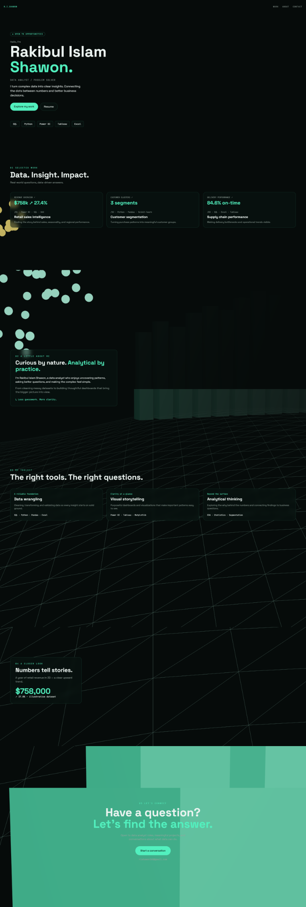

# 3D Data Analyst Portfolio

A 3D portfolio website for data analyst Rakibul Islam Shawon. It combines a
scroll-driven Three.js scene with portfolio sections for selected projects,
analytical skills, and contact information.



## Features

- Animated 3D data visualization, including a wireframe terrain, data points,
  and a revenue bar chart.
- Portfolio sections for projects, about, skills, a data visualization, and
  contact.
- Responsive layouts and scene quality settings for mobile devices and
  reduced-motion preferences.
- A React and TypeScript app built with TanStack Start.

The project and revenue figures shown on the site are illustrative.

## Tech stack

- React and TypeScript
- TanStack Start and TanStack Router
- Three.js with React Three Fiber and Drei
- Vite and Tailwind CSS
- Bun for dependency installation and lockfile management

## Requirements

- Node.js
- [Bun](https://bun.sh/docs/installation)

## Getting started

Open a terminal in the project directory and run:

```sh
bun install --frozen-lockfile
bun run dev
```

Open the local URL printed in the terminal.

The repository includes `bun.lock`; use Bun to install the locked dependencies.
After installing, npm scripts are also available, for example `npm run dev`.

## Available scripts

| Command              | Description                          |
| -------------------- | ------------------------------------ |
| `bun run dev`        | Start the local development server   |
| `bun run build`      | Create a production build            |
| `bun run build:dev`  | Create a development-mode build      |
| `bun run preview`    | Preview the production build locally |
| `bun run lint`       | Run ESLint                           |
| `bun run test`       | Run the test suite once              |
| `bun run test:watch` | Run tests in watch mode              |

## Project structure

```text
src/
  components/Scene3D.tsx   Three.js portfolio background
  lib/                    Scene quality, Three.js helpers, and tests
  routes/                 TanStack file-based routes
  styles.css              Global styles
  test/                   App routing tests
```

The main portfolio page is `src/routes/index.tsx`. The 3D background and its
mobile/reduced-motion rendering policy are implemented in
`src/components/Scene3D.tsx` and `src/lib/scene-quality.ts`.
